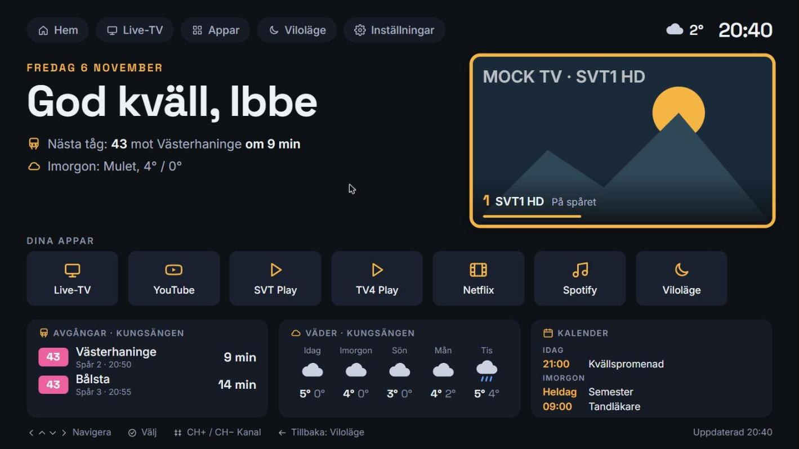
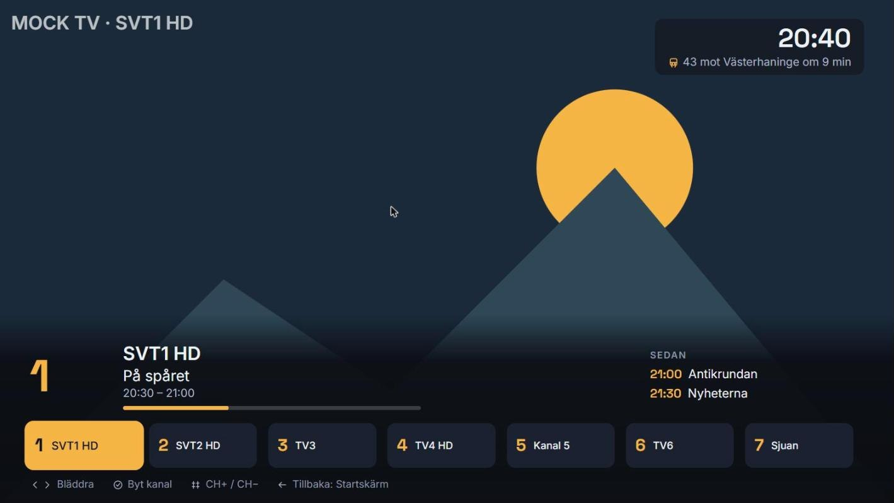
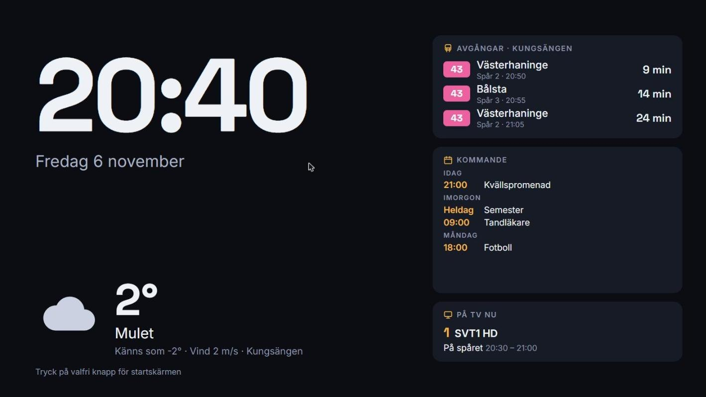

# TV Dashboard

A home screen for older Samsung Tizen TVs (2017, Tizen 3.0). Three screens, fully driven by the remote control, with weather, real-time SL departures, calendar, live TV from the built-in tuner and shortcuts to installed apps. Native TV app, no backend, no API keys.



| Live TV | Idle |
|---|---|
|  |  |

Screenshots from `test.html` in Chrome with mocked TV APIs; on the TV the picture area shows the tuner. The old dashboard next to the stock Samsung home screen is in [docs/screenshot.jpg](docs/screenshot.jpg).

## Screens

1. **Home** – menu bar, greeting with date, next train and tomorrow's weather, a 720×405 live-TV window with channel and programme info, a row of app tiles (Live-TV, YouTube, SVT Play, TV4 Play, Netflix, Spotify, Idle; only installed apps are shown) and three widgets: departures, 5-day weather and calendar.
2. **Live TV** – full-screen tuner. Small clock + next departure top right. Bottom panel with channel number, programme, progress bar, the next two programmes and a 7-channel strip. The panel hides after 5 s and comes back on any key.
3. **Idle** – big clock and date, large weather, and a right column with 3 departures, upcoming calendar events and "on TV now". Starts automatically after 10 minutes without a key press on the home screen.

| Remote button | Home              | Live TV            | Idle |
|---------------|-------------------|--------------------|------|
| Arrows        | Move focus        | Browse channels    | Home |
| OK            | Open / launch     | Tune to channel    | Home |
| CH+ / CH−     | Change channel    | Change channel     | Home |
| Back          | Idle (never exits)| Home               | Home |

Back never closes the app: it is meant to be the TV's home screen. Use *Inställningar → Avsluta appen* to exit.

## Tech notes

Written for the TV's web engine, Chromium 47 on Tizen 3.0: plain ES5 (`var`, `XMLHttpRequest`, no `fetch`, `Promise`, arrow functions, CSS variables, grid or flex gap), no frameworks and no build step. Fonts (Space Grotesk and Inter, OFL) are bundled as WOFF in `app/fonts/` so the TV never depends on Google Fonts.

```
app/
  index.html            page shell, loads the modules below
  css/style.css         fixed 1920×1080 layout, -webkit-prefixed flexbox
  js/config.js          all settings (stop, location, calendar URL, apps, timers)
  js/util.js            helpers, Swedish date names, inline SVG icons, toast
  js/api.js             Open-Meteo, SL departures, iCal parsing + recurrence
  js/tv.js              wrapper around tizen.tvwindow / tvchannel / application
  js/focus.js           spatial focus engine for the remote (zones + arrows)
  js/screens/home.js    screen 1
  js/screens/live.js    screen 2
  js/screens/idle.js    screen 3
  js/main.js            screen switching, keys, idle timer, clock
test.html + test/mock-tizen.js   run everything in Chrome with mocked TV APIs
test.js                          node unit tests for the iCal logic
```

The TV picture is drawn *behind* the page (`tizen.tvwindow.show(..., 'BEHIND')`), so the page background is transparent and the home screen paints everything except the 720×405 hole. If the firmware rejects `BEHIND` the code falls back to `FRONT`.

## Testing in Chrome

```powershell
npx http-server . -p 8765 -c-1
```

Open <http://localhost:8765/test.html>. The mock provides 15 channels, a programme guide, a fake app list (YouTube, SVT Play, Netflix, Spotify; TV4 Play is deliberately missing) and a sample calendar. Keys: arrows, Enter = OK, Backspace/Esc = Back, PageUp/PageDown = CH+/CH−. Weather and SL use the real APIs (both allow CORS).

Syntax check for the TV (must be ES5): `npx acorn --ecma5 --silent app/js/*.js app/js/screens/*.js`. Unit tests: `node test.js`.

## Getting started

Tested on a Samsung UE49M5515. Any Tizen 3.0+ TV should work.

1. **Install [Tizen Studio](https://developer.tizen.org/development/tizen-studio/download)** (default path `C:\tizen-studio`). In Package Manager, Extension SDK, install **TV Extensions** and **Samsung Certificate Extension**.
2. **Enable Developer Mode on the TV.** Open Apps, press `1 2 3 4 5` on the remote, turn on Developer mode and enter your computer's IP. Power-cycle the TV.
3. **Connect:** `C:\tizen-studio\tools\sdb.exe connect <TV-IP>`
4. **Create a certificate** in Tizen Studio: Tools, Certificate Manager, `+`, Samsung, TV. Sign in with your Samsung account and pick a distributor certificate with the **Public** privilege. The TV's DUID is added automatically while it is connected. Note the profile name.
5. **Install:**

   ```powershell
   .\install.ps1 -TvIp <TV-IP> -CertProfile <profile> [-TizenHome C:\path\to\tizen-studio]
   ```

   The script packages, signs, installs and launches the app, and stops with a clear error if any step fails. If PowerShell blocks it, run `Set-ExecutionPolicy -Scope CurrentUser RemoteSigned` once.

## Configuration

Everything lives in `app/js/config.js`. Edit, then reinstall.

- **Stop:** open <https://transport.integration.sl.se/v1/sites>, search for your stop and copy its `id` into `slSiteId`. Kungsängen's commuter trains are site `9700` ("Kungsängens station"). `slTransportModes` and `slLines` filter what is shown.
- **Weather:** `latitude` / `longitude` of your location, `place` is the label.
- **Calendar:** paste an iCal URL into `calendarIcsUrl` (Google Calendar: Settings, your calendar, *Secret address in iCal format*). The link is a secret; don't commit it to a public repo. Supports all-day, multi-day and common recurring events. Leave empty to hide.
- **Apps:** the `apps` list is matched by name against `tizen.application.getAppsInfo()` at start-up; apps that are not installed are hidden. The IDs that were found are shown under *Inställningar* and logged to the console, so you can paste them into `id` if you want to skip the lookup.
- **Timers:** `idleAfterSeconds`, `livePanelHideSeconds`, `refreshWeather`, `refreshSl`, `refreshCalendar`, `refreshProgram`.

## Troubleshooting

- **`failed to connect to <ip>:26101`** although the TV is on: the *Host PC IP* in the TV's Developer Mode must equal your computer's current IP. Both addresses can change with DHCP. Fix it on the TV and restart the TV.
- **`install failed[118]`:** the package is unsigned or has an invalid package id. `package` in `config.xml` must be exactly 10 alphanumeric characters, and `-CertProfile` must match a profile in `tizen security-profiles list`. The install script checks both.
- **Clock shows `--:--` and panels stay on "Hämtar":** a JavaScript syntax error. The TV only understands ES5. Check with `npx acorn --ecma5 --silent app/js/*.js app/js/screens/*.js`.
- **Black box instead of TV picture:** the tuner window could not be shown; a toast says why. Make sure the TV's source is the antenna/cable tuner.
- **No programme titles:** the TV has no EPG data for that channel (or the API is missing on the firmware); the progress bar and "Sedan" are hidden automatically.
- **Developer Mode disappears** after firmware updates. Repeat step 2; the certificate can be reused.

## License

[MIT](LICENSE)
