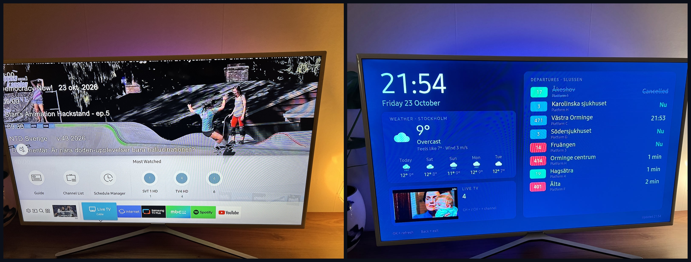

# TV Dashboard

A smart home dashboard for older Samsung Tizen TVs (2017, Tizen 3.0). Clock, weather, real-time Stockholm public transport departures and a live TV window, running as a native TV app with no backend and no API keys.



## Features

- **Clock** with date and weekday
- **Weather** and 5-day forecast from [Open-Meteo](https://open-meteo.com/)
- **SL departures** in real time from [Trafiklab](https://www.trafiklab.se/), with line colours, platforms and disruption notices
- **Live TV** from the built-in tuner in the bottom-left corner via the Tizen TVWindow API, with CH+/CH- channel switching
- **Calendar** (optional) from any iCal/ICS feed, shown instead of live TV

## Tech notes

Written for the TV's web engine, Chromium 47 on Tizen 3.0. That means plain ES5 (`var`, `XMLHttpRequest`, no `fetch`, `Promise`, arrow functions or CSS variables), no frameworks and no build step. The whole app is three JavaScript files and one stylesheet in `app/`.

## Getting started

Tested on a Samsung UE49M5515. Any Tizen 3.0+ TV should work.

1. **Install [Tizen Studio](https://developer.tizen.org/development/tizen-studio/download)** (default path `C:\tizen-studio`). In Package Manager, Extension SDK, install **TV Extensions** and **Samsung Certificate Extension**.
2. **Enable Developer Mode on the TV.** Open Apps, press `1 2 3 4 5` on the remote, turn on Developer mode and enter your computer's IP. Power-cycle the TV.
3. **Connect:** `C:\tizen-studio\tools\sdb.exe connect <TV-IP>`
4. **Create a certificate** in Tizen Studio: Tools, Certificate Manager, `+`, Samsung, TV. Sign in with your Samsung account and pick a distributor certificate with the **Public** privilege. The TV's DUID is added automatically while it is connected. Note the profile name.
5. **Install:**

   ```powershell
   .\install.ps1 -TvIp <TV-IP> -CertProfile <profile>
   ```

   The script packages, signs, installs and launches the app, and stops with a clear error if any step fails. If PowerShell blocks it, run `Set-ExecutionPolicy -Scope CurrentUser RemoteSigned` once.

| Remote button | Action          |
|---------------|-----------------|
| OK            | Refresh all     |
| CH+ / CH-     | Change channel  |
| Back          | Exit the app    |

## Configuration

Everything lives in `app/js/config.js`. Edit, then reinstall.

- **Stop:** open <https://transport.integration.sl.se/v1/sites>, search for your stop and copy its `id` into `slSiteId`. `slTransportModes` and `slLines` filter what is shown.
- **Weather:** `latitude` / `longitude` of your location.
- **Live TV:** `liveTv: true` shows the tuner in the bottom-left corner. Set it to `false` to show the calendar there instead.
- **Calendar:** paste an iCal URL into `calendarIcsUrl` (Google Calendar: Settings, your calendar, *Secret address in iCal format*). Supports all-day, multi-day and common recurring events. Leave empty to hide.
- **Refresh intervals** in seconds: `refreshWeather`, `refreshSl`, `refreshCalendar`.

## Troubleshooting

- **`install failed[118]`:** the package is unsigned or has an invalid package id. `package` in `config.xml` must be exactly 10 alphanumeric characters, and `-CertProfile` must match a profile in `tizen security-profiles list`. The install script checks both.
- **Clock shows `--:--` and panels stay on "Loading":** a JavaScript syntax error. The TV only understands ES5. Check with `npx acorn --ecma5 --silent app/js/app.js`.
- **Developer Mode disappears** after firmware updates. Repeat step 2; the certificate can be reused.
- **Testing in Chrome:** open `app/index.html`. Weather works directly, SL and calendar may be blocked by CORS in a normal browser (not on the TV).
- **Unit tests:** `node test.js` covers the iCal parsing and recurrence logic.

## License

[MIT](LICENSE)
